  

  

  
  
  

---

## 🚀 Sobre mí

- 💼 **Pasantía** en la Empresa Eléctrica Ambato: módulos empresariales con **Angular + Spring Boot** desplegados en WebLogic.
- 🎓 **8.º semestre** de Ingeniería de Software en la Universidad Técnica de Ambato.
- 📦 **Tesis:** trazabilidad de encomiendas con QR, geofencing y modo *offline-first*.
- 🔄 He montado pipelines **CDC con Debezium + Kafka** entre PostgreSQL y MongoDB.
- 🤖 Integro **IA generativa (Gemini)** en aplicaciones reales.
- 📜 Certificado *Data Science Essentials with Python* — Cisco.

 

---

## 🛠️ Tecnologías

<b>Frontend</b>

 

  
  
  
  
  
  

<b>Backend</b>

 

  
  
  
  
  

<b>Datos y mensajería</b>

 

  
  
  
  

<b>DevOps y herramientas</b>

 

  
  
  
  
  
  

---

## 📌 Proyectos destacados

  
  

  
  

---

## 📊 Actividad

  
  

  <picture>
    <source media="(prefers-color-scheme: dark)" srcset="https://raw.githubusercontent.com/AND73321/AND73321/output/github-contribution-grid-snake-dark.svg"/>
    
  </picture>

---

  <b>¿Construimos algo juntos?</b> Escríbeme por <a href="https://www.linkedin.com/in/alejandro-andrade-259a8b40a/">LinkedIn</a> 🤝

  

